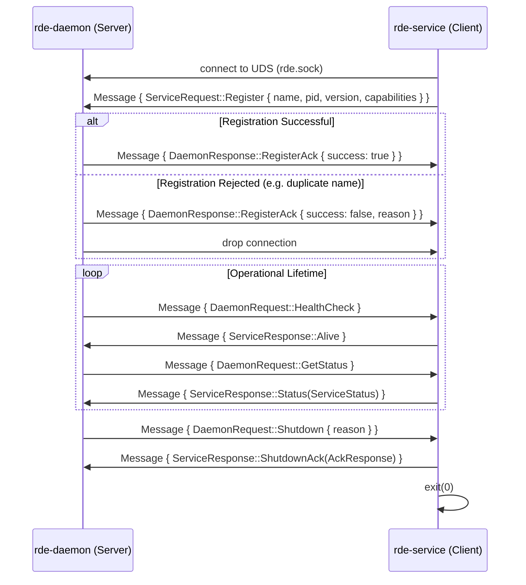

# Internal IPC Protocol

This document specifies the private protocol used between `rde-daemon` and each supervised service over a Unix domain socket, implemented in the `rde-ipc` crate.

This is **not** the public API — external tools should use D-Bus (see [`dbus-api.md`](dbus-api.md)).

## Table of Contents

- [Transport](#transport)
- [Framing](#framing)
- [Message Types](#message-types)
- [Handshake Sequence](#handshake-sequence)
- [Error Handling](#error-handling)
- [Versioning](#versioning)

---

## Transport

- **Socket path**: `$XDG_RUNTIME_DIR/rde/rde.sock` (falls back to `/run/user/<uid>/rde/rde.sock` if `XDG_RUNTIME_DIR` is unset).
- **Ownership**: Created and bound by `rde-daemon` on startup with permissions `0o600` (owner read/write only).
- **Model**: The daemon acts as the Server (Listener). Services act as Clients. Each service connects on startup and holds the connection open for its lifetime.

## Framing

Messages are length-prefixed frames serialized using **Bincode v2** (`bincode::config::standard()`). The binary format is extremely compact.

```

+---------------------+------------------+
| u32 length (Big-End)| payload (Bincode)|
+---------------------+------------------+

```

1. **Length**: A 4-byte unsigned integer (`u32`) in **Big-Endian** byte order representing the size of the serialized payload.
2. **Payload**: The Bincode-serialized `Message` struct.

> **Note:** The maximum allowed payload size is 64 MB (`MAX_PAYLOAD_BYTES`). If a frame exceeds this, the connection is immediately dropped.

## Message Types

### Envelope Wrapper

Every message packet sent across the wire uses the top-level `Message` envelope. It carries routing metadata and the typed payload.

```rust
pub struct Message {
    pub protocol_version: u32,
    pub message_id: u64,
    pub timestamp: u64,
    pub payload: MessagePayload,
}

pub enum MessagePayload {
    DaemonRequest(DaemonRequest),
    DaemonResponse(DaemonResponse),
    ServiceRequest(ServiceRequest),
    ServiceResponse(ServiceResponse),
}
```

### Directionality

To prevent logic errors, the payloads are strictly separated by direction:

- **`ServiceRequest`** (Service → Daemon): Registration, deregistration, and status updates.
- **`ServiceResponse`** (Service → Daemon): Replies to daemon probes (e.g., `Alive`, `Status`, `ShutdownAck`).
- **`DaemonRequest`** (Daemon → Service): Health probes, status requests, and shutdown commands.
- **`DaemonResponse`** (Daemon → Service): Registration acknowledgments (`AckResponse`) and generic success.

## Handshake Sequence

When a service connects, it **must** send a `ServiceRequest::Register` within **5 seconds**. If it fails to do so, the daemon forcefully drops the connection to prevent socket exhaustion.



If a service fails to reply to a `HealthCheck` or `GetStatus` within the required timeout, the daemon assumes the client is hung, drops the connection, and applies its restart policy.

## Error Handling

If a request fails, the Daemon replies with a failed `AckResponse`:

```rust
pub struct AckResponse {
    pub success: bool,
    pub reason: Option<String>, // Populated if success == false
}
```

**Framing Errors:**

- If the daemon reads an invalid length prefix or Bincode fails to deserialize the payload, the connection is immediately terminated.
- If the protocol version is unsupported, the connection is rejected.

## Versioning

The protocol enforces checking compatibility via the `protocol_version` field on every `Message` envelope:

- Current `PROTOCOL_VERSION` is `1`.
- `MIN_PROTOCOL_VERSION` is `1`.
- If a message arrives with a version lower than `MIN_PROTOCOL_VERSION`, the receiver returns `MessageError::UnsupportedProtocol` and drops the connection.
